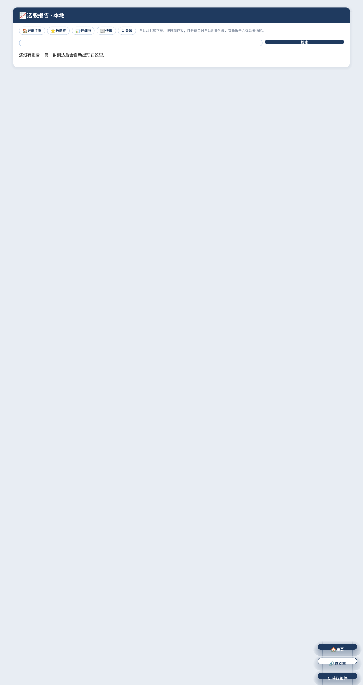
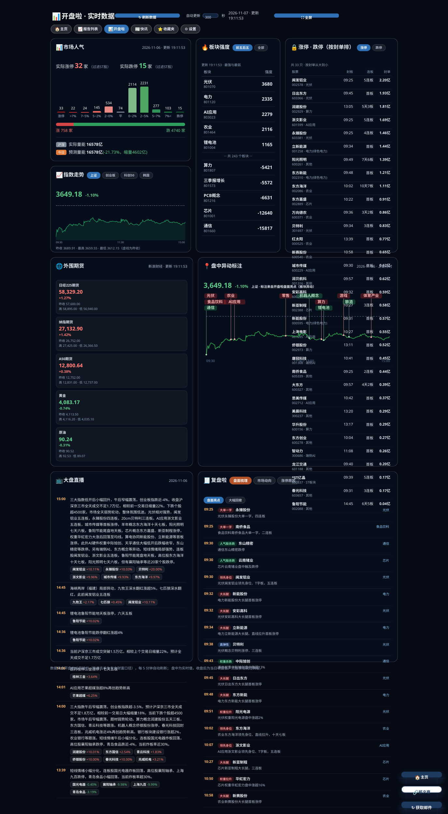
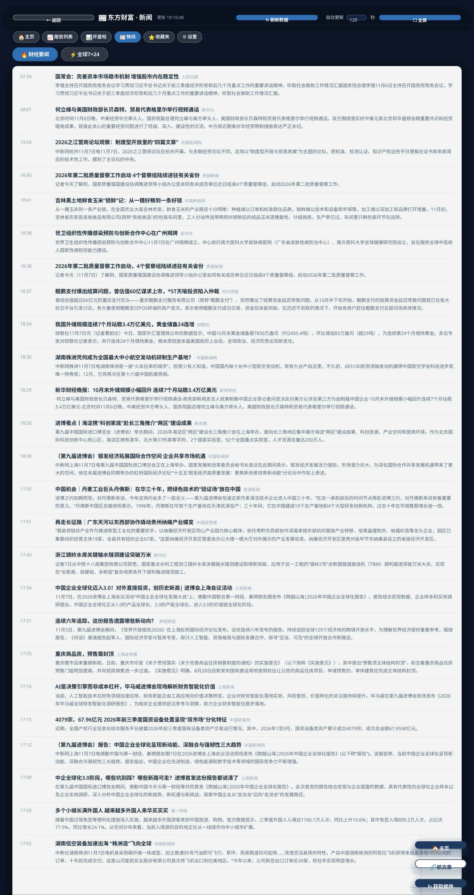
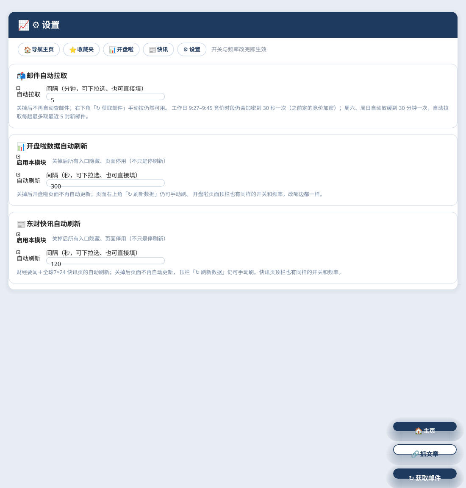

# Mac Mail Reports · 本地邮件报告服务

一个跑在你自己 Mac 上的小型本地服务：自动从邮箱（IMAP）拉取指定发件人的
HTML 报告邮件，按日期存到本地，并提供一个只在本机访问的网页界面来
浏览、检索、收藏这些报告；附带开盘啦市场数据页与东方财富 7×24 快讯页。

- **纯 Python 标准库**，零第三方依赖，单文件服务（`app.py`）
- **只监听 127.0.0.1**，不对外暴露；邮箱授权码只存本地配置文件
- 可选 Hammerspoon 窗口壳：菜单栏入口 + 标签页窗口，像原生应用一样用


## 功能

**报告管理（核心）**

- 定时 IMAP 拉取（默认 5 分钟一趟，工作日竞价时段自动加密到 30 秒，
  周末自动放缓到 30 分钟；每趟最多取最近 5 封新报告）
- 报告按日期归档，列表只显示最近一天，其余进「历史报告」
- 全文检索（标题 + 正文，命中片段标红）
- 收藏分类：给报告打分类，收藏夹按分类分组浏览
- 抓文章：复制文章链接后一键抓取正文 + 评论，转成干净 HTML 存进报告列表
  （公众号图片自动下载到本地，绕开图床防盗链）
- 两段确认删除；已拉取邮件不会被重复拉回
- 授权码连续失效会弹 macOS 通知提醒

**开盘啦数据页**（公开接口，无需登录）

- 市场人气：实际涨停/跌停、11 档涨跌分布、涨跌家数、沪深量能与预测量能
- 板块强度排行（全量分页拉取，前五/后五/全部）
- 涨停、跌停名单按封单额排序
- 指数分时（上证/创业板/科创50/韩国 KOSPI）与盘中异动标注图
- 外围期货：日经225、纳指、A50、黄金、原油
- 复盘啦：盘面亮点、大幅回撤、涨停天梯、涨停原因；大盘直播

**东方财富快讯页**

- 财经要闻与全球 7×24 两个频道分开，热点新闻标红
- 快讯里的个股代码可点，直接跳转本地看盘软件（需 Hammerspoon 配合）

**设置**

- 邮件拉取、开盘啦、快讯三组自动刷新开关与频率（可填任意数值）
- 开盘啦 / 快讯带模块总开关：关掉后入口全部隐藏、页面停用
- 设置保存在本地 `settings.json`，改动约 10 秒内生效

## 截图

> 截图均为演示数据渲染。

| 导航主页 | 报告列表 |
| --- | --- |
|  |  |

| 开盘啦数据 | 东财快讯 |
| --- | --- |
|  |  |

| 设置 |
| --- |
|  |

## 系统要求

- macOS（launchd 托管；窗口壳需要 [Hammerspoon](https://www.hammerspoon.org)，可选）
- 系统自带 python3（没有的话先运行 `xcode-select --install`）
- 一个开启了 IMAP 的邮箱（以 163 邮箱为例，其他支持 IMAP 的邮箱改配置即可）

## 安装

1. 在邮箱网页版开启 IMAP 并生成**客户端授权码**
   （163：设置 → POP3/SMTP/IMAP → 开启 IMAP → 短信验证后生成；
   授权码不是邮箱密码，可随时删除重发）
2. 下载本仓库，双击 `install.command`，按提示输入：
   - 接收报告的邮箱地址
   - 报告发件人邮箱（只有这个地址发来的邮件会被当作报告拉取）
   - 客户端授权码（输入时不显示，正常）
3. 装完自动打开导航主页 `http://127.0.0.1:8765/home`

> 通过 git clone 下载时，若双击 `install.command` 没反应，先在终端执行一次 `chmod +x install.command start.command`（git 快照不保留可执行位）

服务由 launchd 托管，开机自启、崩溃自动拉起；手动启动可双击 `start.command`。

窗口壳（可选）：安装脚本会把 `muse-reports.lua` 放进 `~/.hammerspoon/`，
再在 `~/.hammerspoon/init.lua` 末尾加一行 `pcall(require, "muse-reports")`
并 Reload Config，即可获得菜单栏「📈 报告」入口和标签页窗口。

## 配置

安装时生成的 `config.json` 位于
`~/Library/Application Support/MailReports/config.json`（权限 600）：

| 字段 | 说明 |
| --- | --- |
| `email` | 接收报告的邮箱地址 |
| `auth_code` | IMAP 客户端授权码（**不要提交到任何仓库**） |
| `from_addr` | 报告发件人邮箱，按它过滤邮件 |
| `reports_dir` | 报告存放目录，默认 `~/选股报告` |
| `imap_host` / `imap_port` | IMAP 服务器，163 为 `imap.163.com:993` |
| `interval_sec` | 自动拉取基础间隔（秒），默认 300 |
| `lookback_days` | 拉取回溯天数，默认 4 |

仓库里有 `config.example.json` 可参考。运行期设置（各模块开关与频率）
保存在同目录的 `settings.json`，在网页「⚙ 设置」里改。

## 目录结构

```
.
├── app.py                      # 本地服务（单文件，标准库实现）
├── muse-reports.lua            # Hammerspoon 窗口壳（可选）
├── com.muse.mailreports.plist  # launchd 配置模板
├── install.command             # 一键安装（双击）
├── start.command               # 手动启动
├── config.example.json         # 配置示例
├── nav_wallpaper.jpg           # 导航页壁纸（可选，缺失时用深色底）
└── docs/screenshots/           # 说明截图（演示数据）
```

## 隐私与安全

- 服务只绑定 `127.0.0.1`，没有对外端口、没有账号系统、没有遥测
- 邮箱授权码只出现在本机 `config.json`（权限 600），不经过任何服务器
- 本仓库不包含任何真实配置、邮件内容或报告数据；
  `config.json`、`settings.json`、报告目录已列入 `.gitignore`

## 免责声明

个人学习项目。行情与快讯数据来自第三方公开接口（开盘啦、东方财富、
腾讯、新浪等），版权归原方所有；本项目与上述公司无关，
也不构成任何投资建议。

## License

MIT
